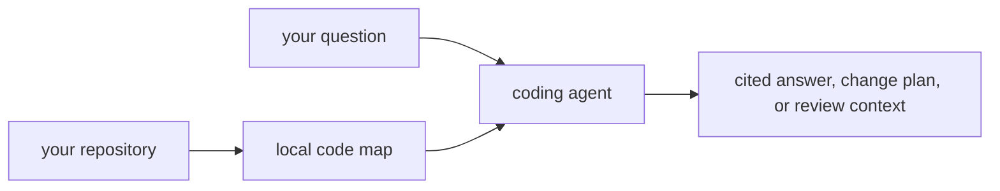
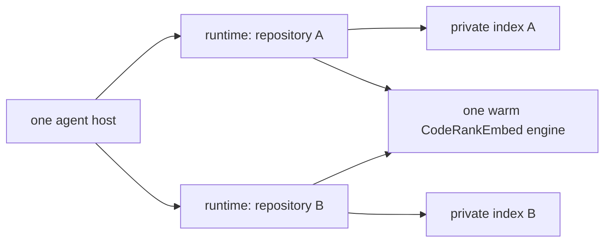

# CodeStory

**A local code map your coding agent can trust.**

[](LICENSE)
[](Cargo.toml)

CodeStory gives coding agents a durable understanding of the repository in
front of them: files, symbols, call paths, routes, snippets, and search evidence.
Answers stay tied to source locations, and incomplete coverage is reported as a
gap instead of being filled with guesses.



The released executable includes CodeRankEmbed Q8 and its accelerator engine.
There is no service to start, model to fetch separately, port to manage, or
retrieval setup to approve. If you install the plugin, it downloads the matching
executable on first use and reports its progress. Source, indexes, and queries
stay local by default.

## What it adds

- **Live code lookups:** find text, locate symbol mentions, and read numbered
  source with `cs find`, `cs refs`, and `cs read`. Lookups work before indexing.
- **Repository grounding:** a compact map of the checkout, its languages,
  components, and important paths.
- **Symbol and impact navigation:** definitions, callers, references, trails,
  routes, and likely tests without repeated whole-tree scans.
- **Broad retrieval:** lexical, semantic, graph, and SCIP evidence combined into
  cited search results and answer packets.
- **Visible limits:** stale, partial, or incoherent evidence fails closed instead
  of looking complete.

## Pick your host

| Host | Start here |
| --- | --- |
| Codex | [Set up shell lookups](docs/users/codex.md) |
| Cursor | [Cursor guide](docs/users/cursor.md) — add the marketplace in Customize |
| Claude Code | [Set up shell lookups](docs/users/claude-code.md) |
| GitHub Copilot | [Copilot guide](docs/users/copilot.md) |

Capability comparison, day-1 checklist, and shared prompts: [User guides](docs/users/README.md).

## Quick start

1. Follow the [setup guide for your host](docs/users/README.md#pick-your-host).
2. Start a fresh agent session in the repository you want to understand.
3. Ask an ordinary code question.

For Codex and Claude Code, run the setup command after installing the 0.18 CLI.
It adds the lookup commands to the agent's standing instructions. The agent
can read current source before the first index exists. This workflow works with
your existing `PATH` and needs no MCP connection.

The optional plugin provides MCP tools for the repository map and broad
retrieval. Its first relevant call prepares the repository. The first broad
search also initializes the embedded model. On that path, one host can work
across several repositories with separate indexes and a shared warm embedding
engine:



**Something blocked?** [Troubleshooting](docs/users/troubleshooting.md).

## Platform support

<!-- codestory-public-support:start -->
| Platform | Release support |
| --- | --- |
| macOS 15+ on Apple Silicon | Supported with Metal |
| Windows x64 | Supported with Vulkan |
| Linux x64 | Supported with Vulkan |
| CPU-only Windows and Linux | Unsupported |
| Intel Mac | Unsupported |
| Windows ARM | Unsupported |
<!-- codestory-public-support:end -->

The table is what the release line ships and intends to prove. A given release
may withhold one platform's accelerator claim when that host was unreachable;
that release's GitHub notes and `release-closeout-summary.json` asset say so
instead of listing the platform as proved. How a claim becomes withheld:
[testing matrix](docs/contributors/testing-matrix.md).

## Example prompts

Use your project's symbols and paths:

**Find ownership**

```text
Where is [Feature] defined, who calls it, and which files should I read first?
```

**Plan a change**

```text
I am changing [path/to/file]. What symbols are affected and what tests should I run first?
```

**Understand a subsystem**

```text
How does [subsystem] work? Cite concrete files and flag gaps if coverage is incomplete.
```

More shapes and host-specific invocation: [User guides](docs/users/README.md#portable-prompt-shapes).

Surfaces, host differences, and platform support: [User guides](docs/users/README.md).

## Documentation

| If you want to... | Read |
| --- | --- |
| Install and use CodeStory | [User guides](docs/users/README.md) |
| Know when to trust agent output | [Trust and readiness](docs/users/trust-and-readiness.md) |
| Repair a blocked session | [Troubleshooting](docs/users/troubleshooting.md) |
| Run CLI repair or debug | [CLI reference](docs/users/cli-reference.md) |
| Change CodeStory itself | [Contributor setup](docs/contributors/getting-started.md) |
| Verify a claim or PR | [Testing matrix](docs/contributors/testing-matrix.md) |

Full routing: [docs/README.md](docs/README.md).

## Evaluation

The trial of `codestory-cli setup codex` compared 12 setup sessions with 12
earlier plain Codex sessions for each repository size. Codex chose to use the
lookups on its own.

| Repositories | Lookups per task | Sessions that received source | Graded requirements (setup vs. plain) | Raw tokens vs. plain |
| --- | ---: | ---: | ---: | ---: |
| Large | 6.67 | 11/12 | 72/75 vs. 74/75 | −0.03% |
| Small | 3.50 | 11/12 | 45/45 in both groups | −17.12% |

The setup missed the correctness target on large repositories. The token
decrease on small repositories applies to that group of sessions. General
token savings and equal correctness across repository sizes remain unestablished.
[Setup confirmation](https://github.com/TheGreenCedar/CodeStory/issues/2637#issuecomment-6898340226)

### Earlier comparisons

The earlier comparison used a hand-configured shell command and standing
instructions, with 36 sessions per arm. Across 12 read-only tasks, Codex
(`gpt-6.1-sol`, high reasoning) averaged 14.1 lookups per task. Blind grading
found 224 of 225 requirements met with lookups and 223 of 225 with plain Codex.

| How Codex received the lookups | Sessions | Lookups per task | Raw tokens vs. plain Codex |
| --- | ---: | ---: | ---: |
| Hand-configured shell command and standing instructions | 36 | 14.1 | +3.1% |
| Plugin with the lookup note in a skill | 12 | 0 | +16.6% |
| Plugin with the skill reworded to lead with lookups | 12 | 1.17 | +31.9% |
| Plugin on small repositories | 12 | 1.08 | +19.7% |

The +3.1% raw-token difference was within the study's noise.
[Standing-instructions study](https://github.com/TheGreenCedar/CodeStory/issues/2637#issuecomment-6889401376)

### Command probes

In command probes on checkouts of about 6,900 to 28,000 files, replies took about
0.2 to 0.9 seconds. All 20 reference probes included every match from the
corresponding whole-word text search. A separate unindexed probe returned live
source in 0.37 seconds. [Installed-candidate probes](https://github.com/TheGreenCedar/CodeStory/issues/2637#issuecomment-6896217366)

For language coverage and repository limits, see
[What to expect](docs/users/what-to-expect.md).

## License

Apache-2.0. See [LICENSE](LICENSE).
